# IMPLEMENTATION_ROADMAP

Effort figures are **planning estimates** made in this review, not measurements. The hackathon plan is written for **2 people (A = backend, B = frontend + assurance)**. A 4-person variant is given where it changes things. Assume a 17-hour event clock; "h7" means hour 7 of the event.

## Phase map

```mermaid
gantt
  dateFormat  HH:mm
  axisFormat  h%H
  section Pre-event (if allowed)
  P0 Decisions, bake-off, contract draft :p0, 00:00, 1h
  section Hackathon
  H1 Contract freeze + skeletons        :h1, 00:00, 1h
  H2 Walking skeleton (A)               :h2, after h1, 4h
  H2 UI shell + runner skeleton (B)     :h2b, after h1, 4h
  M1 SKELETON GREEN + 5 scenarios       :milestone, m1, 07:00, 0h
  H3 Document security + verifier (A)   :h3, 07:00, 3h
  H3 Dossier/PDF viewer UI (B)          :h3b, 07:00, 3h
  H4 LLM tiers + lexicon + ranking (A)  :h4, 10:00, 2.5h
  H4 Map remaining scenarios (B)        :h4b, 10:00, 2.5h
  M2 MVP FEATURE-COMPLETE               :milestone, m2, 12:30, 0h
  H5 Hardening + fairness tests         :h5, 12:30, 2h
  H6 Freeze, record backup, rehearse    :h6, 14:30, 2.5h
```

---

## P0 — Pre-event decisions (only if the organizers allow preparation; otherwise do this in hour 0)

- **Objective:** remove the two unknowns the court flagged, team size and model.
- **Tasks:** commit to a headcount and an A/B (or A/B/C/D) split. Run the model bake-off (TECHNOLOGY_STACK.md). Verify Python 3.12 on every laptop. Read the actual `sentinel/` folder in the repo and list scenario IDs with the endpoints each needs. Prepare 3 multilingual CVs. Write the approval-semantics table (D10) and the questions for organizers.
- **Deliverables:** `DECISIONS.md` (team, model, approval semantics), `openapi` draft, scenario→endpoint table.
- **Definition of Done:** every person can name their hours. The model is chosen with measured numbers.
- **Effort:** 3–5 person-hours.
- **Risk:** prep may be disallowed. Mitigation: everything here also fits in H1 at reduced depth.

## H1 — Contract freeze (h0–h1) · sequential, both people together

- **Features:** none user-visible.
- **Tasks:**
  - Pydantic schemas for every route in SYSTEM_ARCHITECTURE §6;
  - typed error codes;
  - export `openapi.json`;
  - generate the TS client;
  - repo layout `backend/ frontend/ sentinel_hr/ fixtures/`;
  - seed script with 4 users and 2 cases.
- **DoD:** `openapi.json` committed. Both people build against it, and changes after this point need both to agree.
- **Risk:** over-designing. Mitigation: 60-minute timebox; mark unknown fields `Optional`.

## H2 — Walking skeleton (h1–h7) · parallel A ‖ B

**A (backend):**
- auth + RBAC + `case_members` scope;
- cases + criteria confirm;
- upload + SHA-256 + store;
- **naive** extraction (pdfplumber page text);
- **naive** evidence (lexicon only);
- ranking (deterministic);
- proposals with canonical hash;
- approvals (expiry, nonce, single-use, self-approval block);
- gateway → outbox;
- ledger chain + verify.

**B (frontend + assurance):**
- login;
- case list/detail;
- upload with job progress;
- shortlist table;
- proposal / approve / execute buttons;
- `sentinel_hr` runner reading YAML with HTTP steps and assertions on typed error codes and the outbox/ledger;
- implement the **5 demo scenarios** (PI-001, AU-001, AP-001, AP-003, EI-001).

**Milestone M1 (h7), non-negotiable:**
- the full happy path works in the browser;
- the tampered-payload execution returns `409 APPROVAL_PAYLOAD_MISMATCH`;
- the 5 scenarios run over HTTP with real results, recorded to JSONL.

EI-001 and PI-001 may show FAIL at M1 because the verifier isn't built yet. That is honest and expected. If M1 slips, **stop adding features** until it is green. That is the court's condition 1.

- **Tests:** unit tests for hash, approval state machine and ledger; one integration test of the full flow.
- **Effort:** A ≈ 6 h; B ≈ 6 h.
- **Risks:**
  - auth rabbit-hole → use seeded users with no registration;
  - runner/API mismatch → the runner uses the generated contract.

## H3 — Document security + evidence verifier (h7–h10) · parallel

- **A:**
  - pdfplumber char flags (colour, size, off-page);
  - visible/hidden split;
  - instruction-phrase, keyword-stuffing and date-contradiction findings;
  - evidence verifier (normalize, exact match, fuzzy match);
  - unsupported-claim findings.
- **B:**
  - dossier view with pdf.js;
  - quote → page highlight;
  - hidden-text overlay;
  - findings badges.
- **DoD:**
  - all 9 fixtures produce their expected finding (golden test);
  - the clean CV produces zero;
  - EI-001 and PI-001 now PASS.
- **Effort:** A 3 h, B 3 h.
- **Risk:** false positives on the clean CV. Mitigation: thresholds tuned on fixtures, plus a "show why" excerpt.

## H4 — LLM tiers, PII minimizer, full ranking (h10–h12.5) · parallel

- **A:**
  - `ModelAdapter` (hosted, then Ollama, then replay);
  - schema validation + one retry;
  - PII minimizer;
  - ranking flags (borderline profile, finding badge);
  - shortlist confirm;
  - AI-drafted invite text from the candidate's own dossier.
- **B:**
  - map as many of the remaining 19 scenarios as the API supports; tag the rest `BLOCKED` or `UNOBSERVABLE` with the reason;
  - assurance panel;
  - "must open dossier before confirm" UX.
- **Milestone M2 = MVP feature-complete (h12.5):** C1–C12 work. The replay cache is filled from real model runs.
- **Effort:** A 2.5 h, B 2.5 h.
- **Risk:** model latency or outage. Mitigation: replay is filled as soon as the first real run succeeds.

## H5 — Hardening (h12.5–h14.5) · parallel

- Counterfactual fairness pairs.
- Batch of N synthetic CVs: time it and report the measured number.
- Error-path tests (expired, replay, self-approval, cross-case).
- Upload limits; CORS/CSRF check; `ledger/verify` tamper test.
- README sections: approval semantics, what is tested, what isn't.
- **DoD:** the full pytest suite is green; an assurance run produces a report.

## H6 — Freeze and rehearse (h14.5–h17) · sequential

- Code freeze at h15.
- Record the **backup video** of both climaxes. That is the court's condition 3.
- Two timed rehearsals with Wi-Fi off.
- Write the pitch deck.
- Write the README's "measured on N synthetic CVs" numbers.
- **DoD:** both rehearsals finish under 5:00 with no manual fixes.

### 4-person variant
- **C** takes document security + fixtures from h1.
- **D** takes the assurance runner + scenario mapping from h1.

This moves M1 earlier (≈h5) and leaves H5 time for the inbox-digest axis **only if** M2 is green.

---

## MVP vs final product

- **MVP** = the M2 state: one workflow, a sandbox outbox, SQLite, 4 seeded users, synthetic data, and a self-authored assurance suite.
- **The MVP is not the product.** It has no real messaging, no multi-tenancy, no SSO, no external assurance, and no validated buyer.

## Post-hackathon phases (final product)

| Phase | Objective | Key work | DoD | Est. (2–3 engineers) |
|---|---|---|---|---|
| F1 Productionize core | Make the MVP safe to pilot | Postgres + Alembic; OIDC; object storage; secrets management; structured logs; CI with assurance gate | Critical-scenario FAIL blocks deploy | 3–4 weeks |
| F2 Real actions | Replace the outbox | Email adapter (SMTP/Graph), calendar slot proposal, outbox drain worker, idempotency keys | Approved invite delivered once; edited invite never | 3–4 weeks |
| F3 Intake breadth | Real-world CVs | DOCX, scanned PDF (OCR), render-vs-OCR hidden-text differential, Arabic RTL rendering checks | Measured detection on a larger synthetic set | 3–5 weeks |
| F4 More HR axes | Spec axes 2, 3, 5 | Inbox digest, draft replies (same approval path), cited policy Q&A (read-only) | Each axis has its own scenarios | 6–8 weeks |
| F5 Independence | Earn the word | Open scenario format; external contributors / red-teamers; signed assurance reports; ledger head anchoring | At least one third party ran attacks | ongoing |
| F6 Compliance & market | Sell it | DPIA template, retention controls, data-processing agreement with LLM provider or self-hosted option; regulatory review for recruitment AI where customers operate (e.g. the EU AI Act treats employment uses as high-risk); customer discovery interviews | Paid pilot or signed LOI | parallel with F1–F4 |

Dependencies: F1 → F2 → F4. F3 can run alongside F2. F5 and F6 run in parallel throughout.

---

## Optimization register (Phase 7)

| Recommendation | Class | Effect |
|---|---|---|
| Walking skeleton with M1 at h7 | **ESSENTIAL** | Proof first; removes court charges 1 and 3 |
| Freeze OpenAPI at h1 + generated TS client | **ESSENTIAL** | Removes integration drift |
| New thin HTTP runner instead of adapting the SENTINEL simulator | **ESSENTIAL** | Makes the 24 scenarios executable at all |
| Replay cache + backup video | **ESSENTIAL** | Demo reliability |
| Settle team size and model before or at h0 | **ESSENTIAL** | Makes the plan costable |
| Send only visible text to the LLM; no LLM tools | **ESSENTIAL** | Security by containment; also less to detect perfectly |
| Deterministic quote verifier | **ESSENTIAL** | Hallucination control independent of model quality |
| Cut forensics to the 9 fixture classes; defer OCR differential | **HIGH IMPACT** | Saves several hours; lowers false-positive risk |
| One-product story ("Vouch Assurance") | **HIGH IMPACT** | Clarity for judges |
| Multilingual lexicon fallback | **HIGH IMPACT** | Keeps "Intelligent" alive offline |
| Async job + progress for batch upload | **HIGH IMPACT** | Answers "real volumes" without infra |
| Plain functions instead of LangGraph / policy engines | **HIGH IMPACT** | Cuts dev time, fewer deps |
| PII minimizer before the LLM | **HIGH IMPACT** | Privacy and bias; needed for the final product |
| Counterfactual fairness test | **OPTIONAL** (hackathon) / ESSENTIAL (product) | Demonstrates the bias control |
| Docker compose | **OPTIONAL** | Convenience only |
| Presidio | **OPTIONAL** | Better PII coverage in EN/FR later |
| Hypothesis property tests | **OPTIONAL** | Extra confidence |
| Postgres, OIDC, real email/calendar | **FUTURE UPGRADE** | Product, not demo |
| Render-vs-OCR differential | **FUTURE UPGRADE** | Stronger hidden-content detection |
| Ledger anchoring, signed reports, third-party scenarios | **FUTURE UPGRADE** | Real independence |
| Self-hosted inference option | **FUTURE UPGRADE** | Data residency for buyers |

Things that **only add complexity** now: microservices, vector DB, multi-agent orchestration, fine-tuning, a policy engine, Celery/Redis, a second PDF parser.
