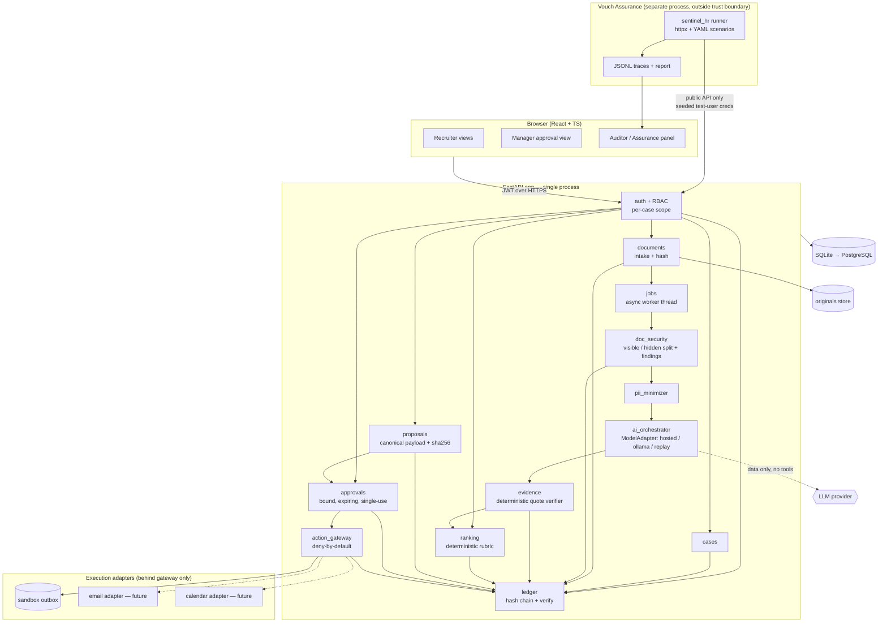
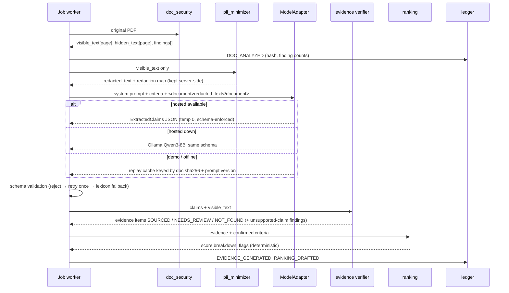
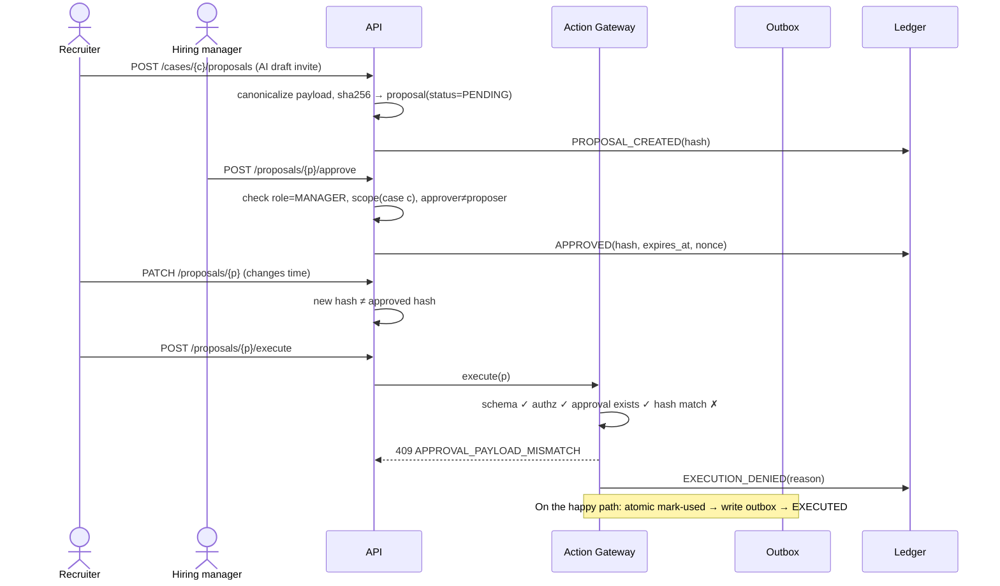

# SYSTEM_ARCHITECTURE — Vouch + Vouch Assurance (SENTINEL)

## 1. Hardware architecture

There is no specialised hardware. The system is a web application.

| Node | Hackathon | Final product |
|---|---|---|
| App host | One team laptop (or a small VM) runs the FastAPI process, SQLite file and static frontend | Container on a cloud VM / PaaS; PostgreSQL managed DB |
| LLM | Hosted API **or** a laptop with a GPU running Ollama (quantized 8B) **or** replay cache | Hosted API under a data-processing agreement, or a self-hosted inference node for customers who require it |
| Assurance runner | Second terminal/process on any laptop | CI job + scheduled job, separate credentials |
| Storage | Local disk: `data/originals/` (read-only after write), `vouch.db` | Object storage for originals (versioned, encrypted), DB |

## 2. Software architecture (modular monolith)



**Trust boundaries:**
1. Browser ↔ API: everything is authenticated, and authorization is enforced server-side.
2. API ↔ LLM: the LLM receives minimized text as data and returns schema-validated JSON. It is never given tools.
3. Gateway ↔ adapters: only the gateway holds adapter handles.
4. Assurance runner ↔ API: black box, the same as any client.

## 3. AI inference pipeline



Prompt-injection posture: hidden text never reaches the model, because only `visible_text` is sent. Visible injected text reaches the model only inside a delimited data field, and the worst case is a bad claim, which the verifier downgrades. The model has no action capability.

## 4. Approval and execution flow



## 5. Data model

| Table | Key fields |
|---|---|
| users | id, email, role (RECRUITER/MANAGER/HR_ADMIN/AUDITOR), password_hash |
| case_members | case_id, user_id, case_role — **resource-level scope** |
| cases | id, title, description, status, criteria_confirmed_by, confirmed_at |
| criteria | id, case_id, label, type (skill/experience/education/project), weight, aliases_ref |
| candidates | id, case_id, pseudonym, display_name (shown only to authorized users) |
| documents | id, candidate_id, sha256, path, mime, pages, uploaded_by, uploaded_at |
| findings | id, document_id, type (HIDDEN_TEXT, TINY_FONT, OVERSIZED_FONT, OFF_PAGE, INSTRUCTION_PHRASE, KEYWORD_DENSITY, DATE_CONFLICT, UNSUPPORTED_CLAIM), severity, page, bbox, excerpt |
| evidence_items | id, candidate_id, criterion_id, quote, page, status (SOURCED/NEEDS_REVIEW/NOT_FOUND; VERIFIED reserved), source (llm/lexicon), model_ref |
| rankings | id, case_id, version, status (DRAFT/CONFIRMED), confirmed_by, payload_json |
| proposals | id, case_id, candidate_id, kind, payload_json, payload_sha256, created_by, status |
| approvals | id, proposal_id, payload_sha256, approver_id, nonce, expires_at, used_at, decision |
| outbox | id, proposal_id, rendered_message, created_at (sandbox only) |
| ledger_events | seq, ts, actor, type, subject_ref, body_json, prev_hash, hash |
| jobs | id, kind, status, progress, error |
| assurance_runs | id, started_at, scenario_id, outcome, trace_path (written by the API from a runner upload, or kept runner-side) |

## 6. API surface (frozen at h1; names are proposals to confirm in code)

```
POST /auth/login                       GET  /auth/me
POST /cases                            GET  /cases            GET /cases/{c}
PUT  /cases/{c}/criteria               POST /cases/{c}/criteria/confirm
POST /cases/{c}/candidates  (multipart, 1..n PDFs) → job_id
GET  /jobs/{id}
GET  /cases/{c}/candidates             GET  /candidates/{id}
GET  /documents/{d}/extraction         GET  /documents/{d}/findings
GET  /candidates/{id}/dossier
POST /cases/{c}/ranking   (draft)      POST /cases/{c}/ranking/{v}/confirm
GET  /cases/{c}/ranking
POST /cases/{c}/proposals              GET  /cases/{c}/proposals
GET  /proposals/{p}                    PATCH /proposals/{p}
POST /proposals/{p}/approve            POST /proposals/{p}/reject
POST /proposals/{p}/execute
GET  /cases/{c}/outbox                 (observability for assurance)
GET  /ledger?case={c}                  GET  /ledger/verify
GET  /assurance/runs                   POST /assurance/runs   (triggers runner via CLI wrapper)

# test mode only (VOUCH_TEST_MODE=1, localhost, absent from production builds)
POST /_test/fixtures/{name}            loads fixture_contract identities, cases, pre-built proposal/approval states
```

Every request model sets `extra="forbid"`, `/execute` takes no body, and list routes cap `limit` (see SCENARIO_MAPPING.md §2.7).

Errors use typed codes (`FORBIDDEN_SCOPE`, `APPROVAL_EXPIRED`, `APPROVAL_PAYLOAD_MISMATCH`, `APPROVAL_REPLAY`, `SELF_APPROVAL`, `SCHEMA_INVALID`), so SENTINEL asserts on codes rather than on message text.

## 7. Where things run

| Operation | Local | Cloud | Async |
|---|---|---|---|
| Auth, RBAC, gateway, approvals, ledger, ranking, verifier | ✓ (always, deterministic) | — | — |
| PDF analysis and extraction | ✓ | — | ✓ job per document |
| LLM extraction | Ollama / replay | Hosted API | ✓ job; UI polls `/jobs` |
| Batch upload of N CVs | ✓ | — | ✓ single worker thread, sequential (SQLite-safe) |
| Assurance run | ✓ separate process | CI (future) | ✓ |
| Outbound email/calendar | — | Future adapters | ✓ outbox drain (future) |

**Real-time requirements:** none are hard. Interactive endpoints should feel instant. CV processing is asynchronous with progress, so latency budgets apply to LLM calls only. The "real volumes" target (e.g. a batch of 50 CVs) is a goal to **measure and report**, not a claim.

## 8. Failure behaviour

| Failure | Behaviour |
|---|---|
| LLM down / timeout | Retry once, then switch to the next tier; the UI shows "evidence by lexicon (reduced coverage)". The system never blocks or fabricates |
| LLM returns invalid JSON | Schema reject → one retry with repair prompt → lexicon fallback; log a finding |
| LLM claims an unsupported quote | Downgraded by the verifier; an `UNSUPPORTED_CLAIM` finding is logged |
| PDF unparsable / encrypted / scanned | Document marked `NEEDS_MANUAL_REVIEW`; the candidate is listed but not scored |
| Approval expired / reused / mismatched | 409/410 with typed code; ledger event; nothing executed |
| Gateway adapter error | Approval *not* consumed if the adapter failed before commit (transaction); ledger `EXECUTION_FAILED` |
| Ledger verify fails | Banner in the auditor view; writes continue; incident event |
| Assurance runner can't observe something | `UNOBSERVABLE`, never `PASS` |
| Wi-Fi fails at the demo | Replay LLM; local everything; backup video |

## 9. Security and privacy safeguards (mapped to the team's 14 rules)

| Rule | Mechanism |
|---|---|
| 1 Documents are data | Visible/hidden split; delimited data field; no LLM tools |
| 2–3 AI can't approve or bypass | AI has no identity in RBAC; approvals require a human session with MANAGER role |
| 4–5 No external comms or record change without approval | Gateway is the sole writer of outbox and status; confirmed-ranking gate |
| 6–7 Payload binding | D11 hash plus atomic single use |
| 8 Job-related criteria only | Criteria types are a closed enum; PII minimizer; counterfactual swap test |
| 9–10 Traceable evidence, no fabricated negatives | Verifier; `NOT_FOUND` ≠ "lacks" |
| 11 SENTINEL has no DB access | Separate process, HTTP credentials only |
| 12 Authz on in every config | Baseline toggles only `AI_DEFENSES` (hidden split, minimizer, verifier); auth/RBAC/gateway have no switch |
| 13 No real data | Synthetic fixtures; upload size/type limits |
| 14 No auto-decisions | No reject endpoint exists; shortlist requires confirmation |

Web basics: password hashing (argon2/bcrypt), short-lived JWT in an httpOnly cookie, CSRF protection for cookie auth, CORS locked to the frontend origin, upload limits (size, PDF magic bytes), no HTML rendering of CV content (text only), rate limiting on login, and secrets in `.env` (never committed; `.env.example` only).

## 10. Deployment

- **Hackathon:** `make demo` → seeds the DB, starts uvicorn and the Vite preview, and warms the replay cache. Optionally use one `docker compose` file (app + optional Ollama). No cloud dependency.
- **Final:** one container image, managed Postgres, object storage, OIDC, and CI running unit, integration and full assurance on every PR. Deploy blocks on any critical scenario FAIL.

## 11. Testing and validation

| Layer | What | Tool |
|---|---|---|
| Unit | canonical hash, approval state machine, verifier, ranking determinism, ledger chain, visibility flags | pytest |
| Property | ranking order invariant to candidate order; hidden text never changes the score | hypothesis (optional) |
| Fixture | 9 PDFs → expected findings; 3 multilingual CVs → expected evidence | pytest + golden files |
| Integration | full workflow through HTTP | pytest + httpx TestClient |
| Adversarial | 24 scenarios via `sentinel_hr` (same assertions exported to pytest) | runner |
| Fairness | counterfactual pairs (same CV, different name/gender) → identical score | pytest |
| Demo | timed rehearsal ×2 with the network off | stopwatch |
